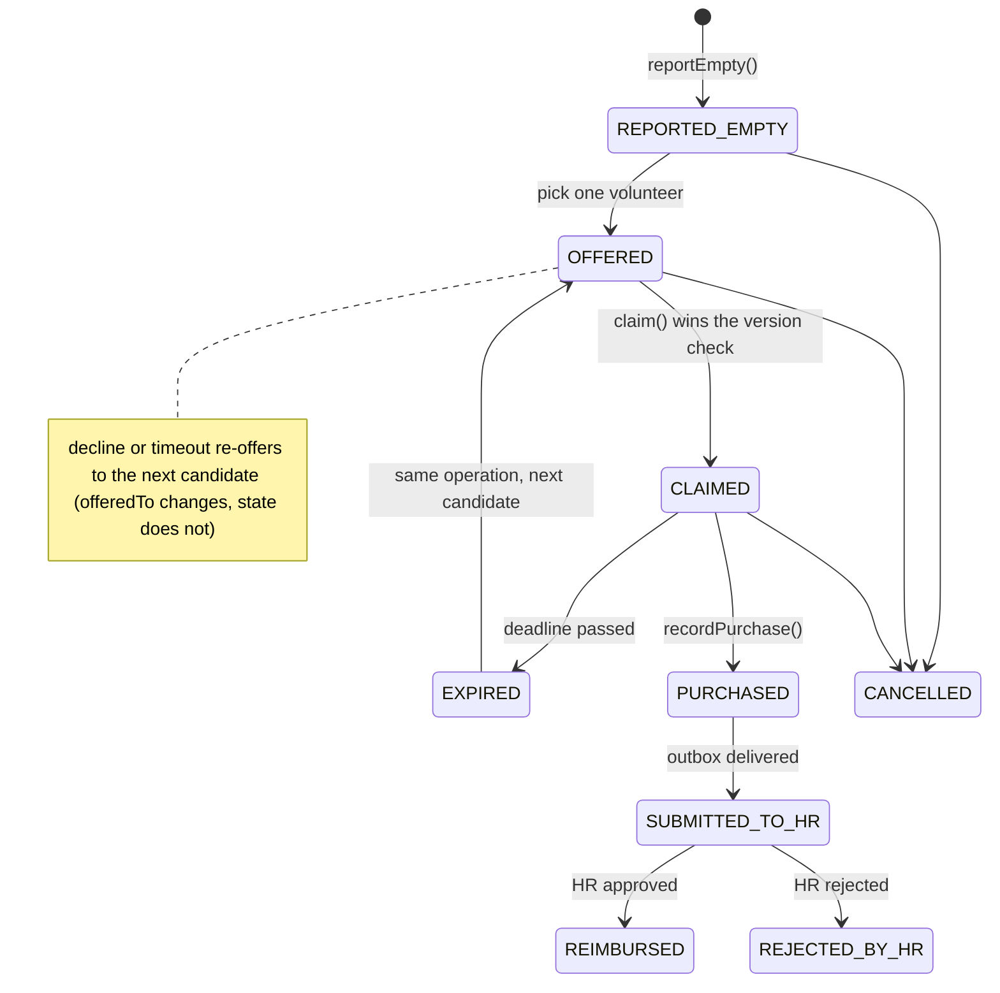

# 10-minute walkthrough

Times in brackets are a guide. Code references are in `code font`.

---

## 1. The problem (1 min)

> Two offices, Oslo and Bengaluru, keep a snack counter stocked by volunteers: about 15 in Oslo
> and 20 in Bengaluru. Volunteers pay with their own money and HR reimburses them later.
>
> Four things go wrong today:
> - the box stays empty because nobody owns the next step;
> - two people buy on the same day;
> - a few people do most of the refills and then wait weeks for their money;
> - nobody knows the total spend.
>
> My approach is to **automate coordination, not shopping**. For every refill the system owns the
> next step: it detects the need, picks **one** person, tracks a deadline, files the HR claim
> **once** and records the spend.

## 2. The refill lifecycle (2 min)

> All legal moves live in **one table**, `TRANSITIONS` in `src/domain/stateMachine.ts`. Any other
> move throws `IllegalTransitionError`, and every move appends `{from, to, at, actor, reason}` to
> the history, so the history doubles as the audit log.
>
> "Active" means the box is still empty: REPORTED_EMPTY, OFFERED, CLAIMED or EXPIRED. Each office
> has **at most one active refill**, so `reportEmpty()` is idempotent. If five people report the
> same empty box, they all get back the same refill. EXPIRED is transient: an expired claim goes
> straight back to OFFERED in the same update, so nothing ever sits in EXPIRED.
>
> **Time.** All time-based work is in one method, `tick()`: offer timeouts, the 50% reminder,
> claim expiry, HR retries and the 10-day HR nudge. Time comes only from the injected `Clock`, so
> tests can jump 24 hours instantly. Every step checks a state or a flag first, which makes
> calling tick twice safe.

## 3. The atomic claim and the Picker (2 min)

> **Atomic claim.** The repository exposes `updateIfVersion(id, expectedVersion, mutate)`, a
> compare-and-set. `claim()` reads the refill, checks that it is OFFERED **to this caller**, then
> writes only if the version is unchanged. If two taps race, the first write bumps the version and
> the second gets a `ConflictError`, which I turn into a clear `ClaimRejectedError`.
>
> The in-memory repo awaits a microtask before the check, so concurrent calls really interleave in
> tests. The check and the write after that await are synchronous, so nothing can slip in between.
> The concurrency test fires four claims and asserts that exactly one wins, the state is CLAIMED
> once and the history has one claim.
>
> **Claim lease.** A claim lasts 24 hours, with one reminder at 12 hours. At the deadline the claim
> expires: the system releases the budget reservation, increments that volunteer's `expiryCount`
> and offers the refill to the next person.
>
> **Picker** (`src/services/Picker.ts`) is a pure function. It is easy to test and has no I/O. It
> filters for volunteers who are:
> - in this office **today**, so a visitor counts where they are;
> - not on leave;
> - not someone who already declined or timed out on this refill;
> - below the limit for money waiting at HR, per currency.
>
> It then sorts by fewest refills in the last 30 days, then longest since their last refill, then
> fewest expiries, then id. Returning the whole ranked list makes "pass it on" trivial: take the
> next one. The fairness test runs 20 volunteers through 60 refills and gets a spread of at most 1.

## 4. Budget and currency (2 min)

> **Money** is `{ amount: integer minor units, currency }`, so there are no floats. Adding or
> comparing NOK with INR throws. The only rounding is in currency conversion, with `Math.round`.
>
> **BudgetLedger** has two entry types, RESERVED and SPENT.
> - **At claim time** I hold the office's reserve amount (1,200 NOK or 3,000 INR), about the
>   largest typical purchase. Only the winning claim writes it: I check the budget first, then win
>   the version check, then write the reservation.
> - **Over budget:** if SPENT + RESERVED + the new reservation would exceed the budget, the claim
>   is blocked, the refill stays OFFERED and a manager is messaged. `approveOverride()` lets it
>   through, because going over budget is a human decision.
> - **At 80%** of budget, `claim()` returns a warning flag.
> - **At purchase**, `settle()` replaces the reservation with the real SPENT amount, and flags it
>   if the purchase cost more than the reservation.
>
> **Month boundaries.** The month is computed **in the office's timezone** with
> `Intl.DateTimeFormat`. At 23:30 UTC on 31 January it is already February in both Oslo and
> Kolkata. At 22:00 UTC the two offices disagree, and the test covers both cases.
>
> **The report** gives native totals per office, plus one combined NOK figure using a rate
> snapshot that the report itself carries (rate and as-of date). Native amounts stay the source of
> truth.

## 5. HR, tests and simulation (2 min)

> **HR outbox.** `recordPurchase()` changes state, settles the ledger and enqueues an outbox item.
> It never calls HR directly. `tick()` flushes the outbox, using the **refill id as the
> idempotency key**, so retries and double flushes can never create a second claim. A failure
> backs off exponentially (1, 2, 4… minutes, capped at 6 hours). The fake HR rejects duplicate
> keys, and a test asserts we never send one. On delivery the refill moves to SUBMITTED_TO_HR.
> HR's approve or reject arrives through `handleHrStatus()`. A rejection notifies a manager but
> keeps the SPENT entry, because the snacks were bought.
>
> **Tests.** There are 42 Vitest tests, all deterministic. They use a FakeClock and FakeChat that
> records every message, so there is no real waiting.
>
> **Simulation.** `npm run simulate` runs 90 seeded days with leave, remote days, visits, random
> empty boxes, purchase amounts and HR delays. It runs once with our Picker and once with a naive
> baseline where the same 3 people always answer first. With our Picker, Oslo is at most 1 refill
> per person and Bengaluru at most 2. With the baseline, one Bengaluru volunteer does 14 refills
> and the peak money owed to one person doubles.

## 6. What I did not build (1 min)

> - Real chat, HR, database or scheduler adapters. The ports are there; adapters would plug in
>   without changing the services.
> - A cancel API. CANCELLED is in the transition table, but no requirement asked for an action
>   that reaches it.
> - Escalation when **everyone** has passed on a refill. It stays OFFERED to nobody and the
>   channel is told. In practice a manager steps in.
> - Authentication, a UI, receipt OCR, live exchange rates and multi-process locking. In
>   production the compare-and-set would be a `WHERE version = ?` update in the database.

---

## Likely interviewer questions

1. **Why optimistic locking rather than a mutex?**
   It is the same pattern a database gives you (`UPDATE … WHERE version = ?`). It works across
   processes, and losers get a clear error instead of waiting.

2. **What if HR received the claim but our process crashed before marking it sent?**
   The next flush resends it with the same key. HR answers "duplicate", and the outbox treats that
   as sent. The key is what makes at-least-once delivery safe.

3. **Why is the budget checked before the claim but written after?**
   So that only the winning claim writes a reservation. If losers had reserved and then released,
   they could remove the winner's reservation.

4. **Why reserve a fixed amount instead of asking the volunteer for an estimate?**
   It is one less question for the volunteer, and it covers a typical maximum purchase. A purchase
   above the reservation is still recorded and flagged.

5. **How do visitors work?**
   The Picker uses `currentOffice`, not `homeOffice`. Their receipt is in the local currency, and
   HR pays them in their payroll currency. That conversion is HR's job, not ours.

6. **Why is REMOTE still eligible?**
   The spec only excludes ON_LEAVE, and a remote volunteer has 24 hours and may be in tomorrow.
   They can decline in one tap.

7. **How do you stop the bot spamming people?**
   Only one person gets an offer at a time. There is one reminder per claim and one HR nudge per
   claim, and both are marked before sending. The "nobody available" channel message is sent once,
   not on every tick.

8. **Is `tick()` safe if two schedulers call it?**
   Yes. Each step is guarded by state or a flag, and every write is a version-checked update. A
   tick that loses a race skips that refill, and the next tick sees fresh state.

9. **Why convert to NOK only in the report?**
   Budgets are in native currency, so the ledger stays native and exact. Conversion happens once,
   in the report, with a stated rate and date, so the number can be reproduced.

10. **How would you take this to production?**
    I would implement the ports with Slack or Teams, the HR API and Postgres (a version column plus
    the outbox table), and run `tick()` from a cron job every few minutes. The services and tests
    would not change.
